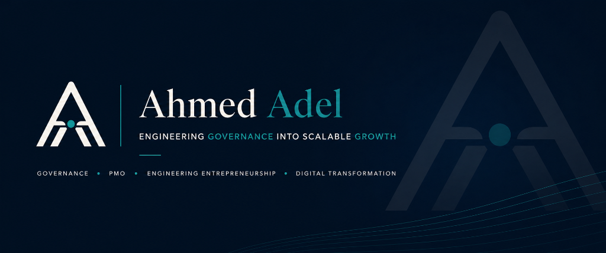
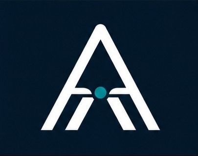

<p align="center">
  
</p>

<p align="center">
  <h1 align="center">📐 Antigravity Process Architect</h1>
  <h3 align="center">The Universal Visual Architecture & Workflow Engine for Google Antigravity</h3>
  <p align="center"><strong>ENGINEERING GOVERNANCE INTO SCALABLE GROWTH</strong></p>
  <p align="center"><em>المحرك البصري الشامل للأنظمة المعمارية ومسارات العمل — حوّل أي فكرة، معمارية برمجية، بنية تحتية سحابية، أو مسار تنفيذي إلى مخططات تفاعلية حية بدون كتابة كود.</em></p>
</p>

<p align="center">
  <a href="LICENSE"></a>
  <a href="#"></a>
  <a href="#"></a>
  <a href="#"></a>
  <a href="#"></a>
</p>

---

<div dir="rtl" align="right">

## 🌟 لماذا Process Architect؟

سواء كنت **مهندساً معمارياً للبرمجيات (Software/Cloud Architect)**، **مدير مكتب إدارة مشاريع (PMO Director)**، **استشارياً تنظيمياً**، أو **قائداً تقنياً**، فإنك تواجه تحدياً مستمراً: **كيف تحول الأفكار المعقدة، المعماريات البرمجية، خطوط تدفق البيانات، ومسارات العمل إلى مخططات تفاعلية مبهرة ومفهومة دون إضاعة ساعات في أدوات الرسم اليدوية؟**

**Process Architect** هو المحرك البصري الشامل لبيئة **Google Antigravity** الذي ينقل التوثيق وتصميم الأنظمة إلى عصر الوكلاء الأذكياء:

1. **شامل وعام (Universal Architecture):** لا يقتصر على مجال واحد؛ بل يرسم أي معمارية برمجية (Microservices/APIs)، بنية تحتية سحابية (AWS/GCP/Azure)، قواعد بيانات (ERD)، خطوط بيانات (ETL Pipelines)، أو مسارات عمل إجرائية وإدارية.
2. **تفاعلي ومستقل بالكامل (Interactive Standalone HTML):** ينتج ملفات HTML تفاعلية مدمجة تحوي كود SVG النقي، تدعم التكبير (Zoom/Pan)، تدفق الإشارات التفاعلي (Live Signal Flow)، عزل المسارات (Route Tracing)، والتبديل الفوري بين المظهرين الليلي والنهاري.
3. **تدقيق معماري صارم (Architectural Linter):** يمر كل مخطط عبر 4 بوابات فحص هندسية تمنع تداخل الخطوط، تضمن تناسق المسافات، وتصحح مسارات التدفق آلياً.
4. **أمان مؤسسي كامل (100% Offline & Corporate-Safe):** يعمل المحرك محلياً بالكامل على جهازك دون إرسال أي أسرار معمارية أو بيانات مؤسسية خارج بيئة عملك.

---

## 🚀 كيفية تفعيل واستخدام المهارة بعد التثبيت (Activation & Usage Guide)

بمجرد تثبيت المهارة على جهازك، تصبح جاهزة للعمل فوراً داخل محادثة **Google Antigravity** بعدة طرق مرنة:

### 1. التفعيل التلقائي بالذكاء الاصطناعي (Natural Intent Detection)
لا تحتاج لحفظ أوامر معقدة؛ بمجرد أن تطلب من Antigravity أي طلب يتضمن رسماً أو توضيحاً معمارياً، سيقوم بتفعيل **Process Architect** تلقائياً:
- *"ارسم لي معمارية نظام تجارة إلكترونية معتمد على Microservices و Kafka و Redis"*
- *"وضح لي دورة حياة مصادقة المستخدم وتوثيق توكن JWT في مخطط تسلسلي (Sequence Diagram)"*
- *"اعمل لي مخطط ERD لقاعدة بيانات إدارة الطلبات والمخازن مع المفاتيح الأساسية والخارجية"*
- *"ارسم مسار سير عمل خط تدفق البيانات (Dataflow Pipeline) من التجميع حتى لوحة المؤشرات"*
- *"حول لي كود الـ Mermaid التالي إلى مخطط تفاعلي حي"*

### 2. الاستدعاء الصريح بالاسم (Explicit Invocation)
يمكنك استدعاء المهارة مباشرة بذكر اسمها لضمان تطبيق أعلى معايير الجودة:
> *"استخدم مهارة **Process Architect** لرسم معمارية البنية التحتية السحابية لهذا المشروع."*

### 3. ما الذي ستحصل عليه في كل مخرج؟
عند طلب أي مخطط، ستحصل دائماً على:
1. **معرض صور مرئي (Visual Carousel):** لقطات شاشة عالية الدقة للوضعين الليلي والنهاري مباشرة داخل المحادثة.
2. **رابط المخطط التفاعلي الحي (Interactive HTML):** يمكنك فتحه بضغطة زر للتنقل والتصدير.
3. **الأركان الثلاثة المعرفية الإلزامية:** (طريقة الاستخدام + التحليل المعماري + جدول المؤشرات).

---

## 🎯 الأركان الثلاثة الإلزامية لكل مخرج (The 3-Pillar Promise)

يلتزم **Process Architect** بقاعدة استشارية صارمة: **لا يُسلّم أي مخطط كصورة مجردة صامتة**، بل يُرفق معه دائماً الأركان الثلاثة التالية:

1. **🛠️ طريقة الاستخدام والتفاعل (Interactive Controls & How-to-Use):**
   - ⚡ **التحكم بالحركة (Flow / Still):** تفعيل أو تجميد تدفق الإشارات التفاعلية عبر مسارات النظام.
   - 🔍 **التنقل والتمركز (Zoom & 100% Fit):** التكبير الدقيق وزر التمركز السريع في منتصف الشاشة.
   - 🎯 **عزل المسارات (Focus & Route Tracing):** النقر على أي عقدة لعزل علاقاتها وتعتيم باقي العناصر.
   - 🌓 **المظهر (Theme):** التبديل الفوري بين الوضع الداكن والفاتح.
   - 💾 **التصدير (Export):** حفظ فوري بصيغ `SVG` متجهات نقي، `PNG` عالي الدقة، أو `WebM` فيديو متحرك.
2. **🧠 فهم المخرجات والتحليل المعماري (Output Breakdown & Architecture Analysis):**
   - تحليل طبقات النظام وتفكيك مسؤوليات كل مكون.
   - شرح رحلة تدفق الطلبات والبيانات خطوة بخطوة من البداية وحتى المحطة النهائية.
   - إبراز القرارات الهندسية ونقاط الحماية والاعتمادية.
3. **📊 جدول المؤشرات والدلالات البصرية (Visual Indicators & Legends Matrix):**
   - جدول مرجعي يفسر دلالة كل لون (الواجهات، الأمان، المعالجة، قواعد البيانات).
   - توضيح معاني الخطوط (صلب متزامن، متقطع غير متزامن، أحمر أمني).
   - توضيح دلالات الشارات الفرعية والوسوم (`Tags`).

---

## 📐 الأنماط المعمارية الـ 10 المدعومة بالكامل

| النمط المعماري | الاستخدام الهندسي | أمثلة تطبيقية |
|---|---|---|
| **Architecture** | البنية التحتية، الخدمات المصغرة، والشبكات السحابية | Web Apps, Kubernetes Clusters, Cloud Networks |
| **Workflow** | مسارات العمل، بوابات القرار، وتنفيذ مهام الوكلاء | Approval Chains, CI/CD, Agent Pipelines |
| **Sequence** | تسلسل استدعاءات الـ APIs والمصادقة والاتصالات | OAuth2, Async Jobs, Microservice Interop |
| **Dataflow** | خطوط معالجة وتدفق البيانات وحوكمتها | ETL/ELT Pipelines, Event Streams, Data Lakes |
| **Lifecycle** | آلات الحالات وانتقال مراحل الكيانات | Order States, Machine States, Job Retries |
| **ERD** | قواعد البيانات والكيانات والمفاتيح والعلاقات | Relational Schemas, Database Modeling |
| **Class** | الفئات البرمجية وعلاقات الوراثة والتنفيذ | OOP Hierarchies, Type Systems, Interfaces |
| **Tree** | التدرج الهرمي وتفكيك المكونات والمجلدات | Module Decomposition, Directory Trees, Org Structure |
| **Timeline** | التتبع الزمني للأحداث والمراحل والحوادث | Incident Reviews, Release Timelines, Audits |
| **Waterfall** | تحليل مدد التأخير وأزمنة تنفيذ العمليات | Request Latencies, Execution Profiling |

---

## ⚡ التثبيت السريع بنقرة واحدة (One-Click Install)

### لمستخدمي Windows (PowerShell):
```powershell
irm https://raw.githubusercontent.com/drengahmedadel-gov/antigravity-process-architect/main/install.ps1 | iex
```

### لمستخدمي macOS / Linux (Terminal):
```bash
curl -fsSL https://raw.githubusercontent.com/drengahmedadel-gov/antigravity-process-architect/main/install.sh | bash
```

### أو من داخل محادثة Antigravity مباشرة:
> *"قم بتثبيت مهارة Process Architect من المستودع: `https://github.com/drengahmedadel-gov/antigravity-process-architect`"*

---

## 👨‍💻 عن المطور والخدمات الاستشارية (About Ahmed Adel)

<div align="center">
  <table border="0" style="border: none; background: transparent;">
    <tr>
      <td width="130" align="center" valign="middle" style="border: none;">
        
      </td>
      <td valign="middle" style="border: none; padding-right: 20px;">
        <h2 style="margin: 0; color: #0D9488;">د.م. أحمد عادل | Dr. Eng. Ahmed Adel</h2>
        <p style="margin: 4px 0; font-size: 14px; letter-spacing: 1px; color: #0A192F;"><strong>ENGINEERING GOVERNANCE INTO SCALABLE GROWTH</strong></p>
        <p style="margin: 2px 0; font-size: 13px; color: #475569;">
          <strong>GOVERNANCE</strong> &nbsp;•&nbsp; <strong>PMO</strong> &nbsp;•&nbsp; <strong>ENGINEERING ENTREPRENEURSHIP</strong> &nbsp;•&nbsp; <strong>DIGITAL TRANSFORMATION</strong>
        </p>
      </td>
    </tr>
  </table>
</div>

### الركائز الاستشارية والمهنية الأربع:

1. **🏛️ الحوكمة المؤسسية والرقابية (Governance):**
   - تصميم وتطبيق أطر الحوكمة الرصينة، مصفوفات الصلاحيات (Delegation of Authority)، وإدارة الامتثال والمخاطر المؤسسية.
2. **📊 مكاتب إدارة المشاريع (PMO Setup & Strategic Execution):**
   - تأسيس وتطوير مكاتب إدارة المشاريع المؤسسية (EPMO/PMO) لربط الاستراتيجيات بالمشاريع التنفيذية وفق أعلى المعايير الدولية.
3. **🏢 ريادة الأعمال الهندسية وتأسيس الشركات (Engineering Entrepreneurship & Venture Building):**
   - استشارات تأسيس وهيكلة الكيانات الجديدة والشركات الناشئة، وبناء نماذج التشغيل القابلة للتوسع (Scalable Business Models).
4. **🤖 التحول الرقمي وتمكين الذكاء الاصطناعي (Digital Transformation & AI Enablement):**
   - ميكنة وأتمتة العمليات اليومية، ودمج وكلاء الذكاء الاصطناعي المتقدمة (Autonomous AI Agents) والـ Docs-as-Code في صلب البنية التشغيلية للمؤسسات.

---

### 📬 قنوات التواصل والاستشارات المباشرة:

<p align="right">
  <a href="https://www.linkedin.com/in/engineerahmedadel" target="_blank">
    
  </a>
  <a href="https://wa.me/201065310008" target="_blank">
    
  </a>
  <a href="tel:+201065310008">
    
  </a>
</p>

- **لينكدإن (LinkedIn):** [linkedin.com/in/engineerahmedadel](https://www.linkedin.com/in/engineerahmedadel)
- **الهاتف / واتساب المباشر:** `+201065310008`
- **حساب GitHub:** [@drengahmedadel-gov](https://github.com/drengahmedadel-gov)

---

## ⚖️ الحقوق الفكرية والترخيص (License & Attribution)

هذا المشروع منشور تحت رخصة **[MIT License](LICENSE)**.  
المحرك البرمجي الداخلي للتصيير مبني ومطور استناداً إلى نواة محرك **Archify** الأصلي لمطوره `tt-a1i` مع كامل التقدير والإسناد الأدبي والمهني، وتمت ترقيته وإعادة تصميمه ليصبح المحرك الشامل لمنظومة **Google Antigravity**.

</div>

---

## 🌐 English Overview (For Global Visitors)

<p align="center">
  <strong>ENGINEERING GOVERNANCE INTO SCALABLE GROWTH</strong><br/>
  <em>GOVERNANCE • PMO • ENGINEERING ENTREPRENEURSHIP • DIGITAL TRANSFORMATION</em>
</p>

**Antigravity Process Architect** is the universal, enterprise-grade visual architecture and workflow engine built specifically for **Google Antigravity**.

- **Universal Scope:** Supports 10 distinct architectural models: Systems, Microservices, Cloud Networks, Workflows, Sequences, Dataflow Pipelines, Lifecycles, ERD Database Schemas, Class Diagrams, Timelines, and Waterfall Latencies.
- **Interactive Standalone HTML:** Produces self-contained interactive files featuring live signal flow animations, route tracing, reach isolation, dark/light modes, and SVG/PNG/WebM exports.
- **Mandatory 3-Pillar Response:** Every generated diagram includes:
  1. *Interactive Controls Guide* (How to explore and control the visual).
  2. *Architectural & Workflow Breakdown* (Layer-by-layer technical analysis).
  3. *Visual Indicators Matrix* (Color-coded meanings, line semantics, and badges).
- **100% Offline & Corporate-Safe:** Zero external cloud dependencies; all rendering and validation occurs locally on your machine.

### One-Click Installation
- **Windows (PowerShell):**
  ```powershell
  irm https://raw.githubusercontent.com/drengahmedadel-gov/antigravity-process-architect/main/install.ps1 | iex
  ```
- **macOS / Linux (Bash):**
  ```bash
  curl -fsSL https://raw.githubusercontent.com/drengahmedadel-gov/antigravity-process-architect/main/install.sh | bash
  ```

---
*Created and maintained by **Dr. Eng. Ahmed Adel (Dr.PMO)** — Consultant in Governance, PMO Setup, Engineering Entrepreneurship, and Digital Transformation.*
